# 📸 WireDoctor Report Tour

A guided walkthrough of the WireDoctor HTML console, tab by tab. Every screenshot and GIF here is from a **real, unmodified run against [start.spring.io](https://github.com/spring-io/start.spring.io)** — Spring Initializr itself — on WireDoctor **1.2.0** (Spring Boot 4.1.x, **394 beans · 435 wiring edges**, `test` profile). Nothing is staged: no demo beans, no injected cycle. What the diagnostics find is what a real, well-maintained Spring app actually looks like — including **3 hidden module-boundary violations** nobody had noticed. The full sample report set is in [`sample/v1.2.0/`](https://github.com/ddsha441981/wiredoctor/tree/main/sample/v1.2.0).

The report is a single self-contained `wiredoctor-report.html` — the graph library is inlined at generation time, so it renders completely offline. Just open it in a browser.

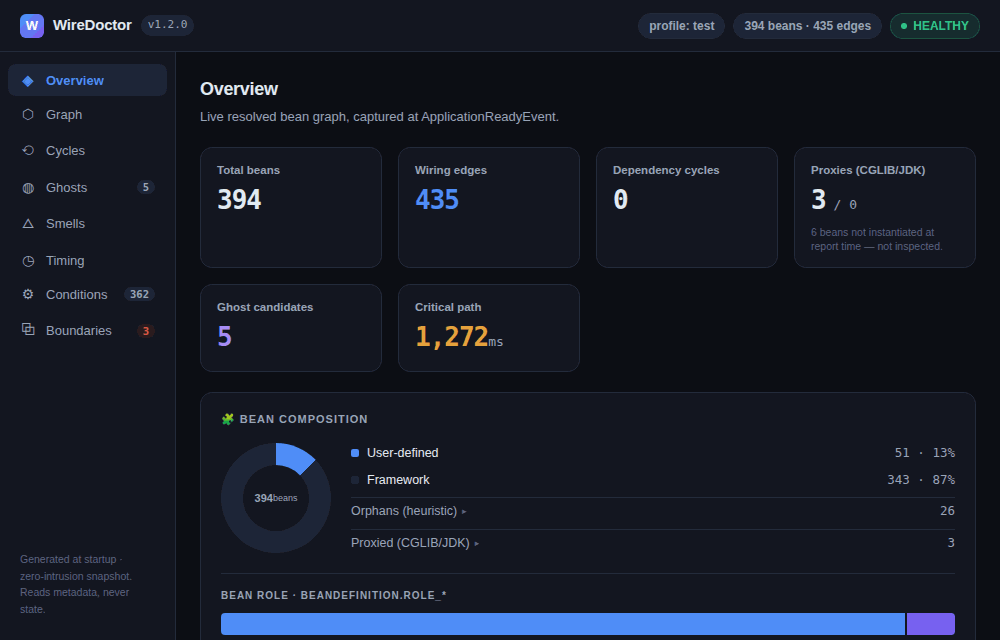

---

## Overview tab

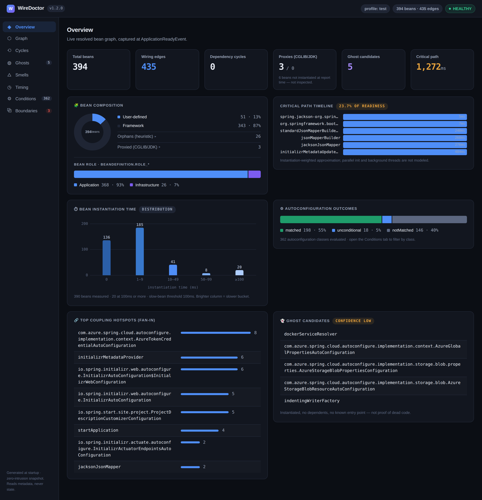

The landing tab — everything at a glance:

- **Header chips (top-right)**: version, active profile, bean/edge counts, and the health verdict. Here it reads **`HEALTHY`** (green) — no cycles, no armed gate tripped. The chip follows a strict precedence: `GATE FAIL` → `N CYCLES` → `GATES PASS` → `HEALTHY`, so the worst news always wins.
- **Stat cards**: total beans (394), wiring edges (435), dependency cycles (0), CGLIB/JDK proxies (5), ghost candidates (5), and the startup critical-path cost (1,272ms).
- **Bean composition**: user-defined vs framework beans (51 vs 343 — a real app is mostly framework), 26 heuristic orphans, and the `BeanDefinition.ROLE_*` split (368 application · 26 infrastructure).
- **Critical path timeline**: the single most expensive dependency chain to readiness — here it ends at `initializrMetadataUpdateStrategy` and accounts for **23.7%** of startup. This is where a `@Lazy` or a lighter bean pays off most.
- **Bean instantiation distribution** and **autoconfiguration outcomes** (198 matched · 18 unconditional · 146 notMatched of 362 classes) round out the page.

The sidebar footer states the trust posture: *generated at startup, zero-intrusion snapshot — reads metadata, never state*.

---

## Graph tab

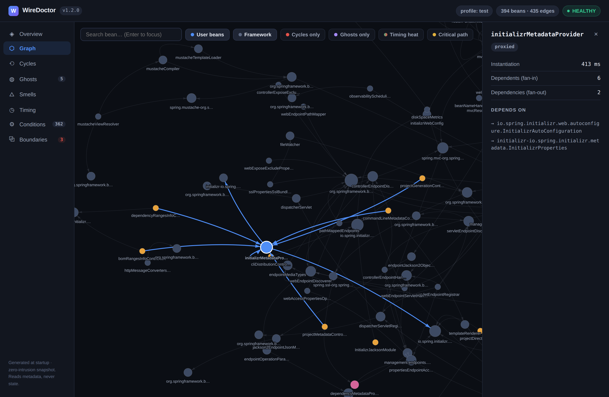

The full resolved dependency graph, rendered interactively. Filter chips toggle **User beans / Framework / Cycles only / Ghosts only**, and the search box focuses any bean by name. Two chips bring startup timing into the graph (v0.10.0): **Timing heat** recolors nodes green→red by per-bean instantiation time, and **Critical path** traces the readiness chain in gold.

Clicking a node — or searching and pressing Enter — opens the **inspector panel**: health, instantiation time, an `on critical path` tag, fan-in (dependents), fan-out (dependencies), and the exact dependency list. Here `initializrMetadataProvider` — a central bean in Initializr — is focused, so you can answer "what actually depends on this?" without grepping.

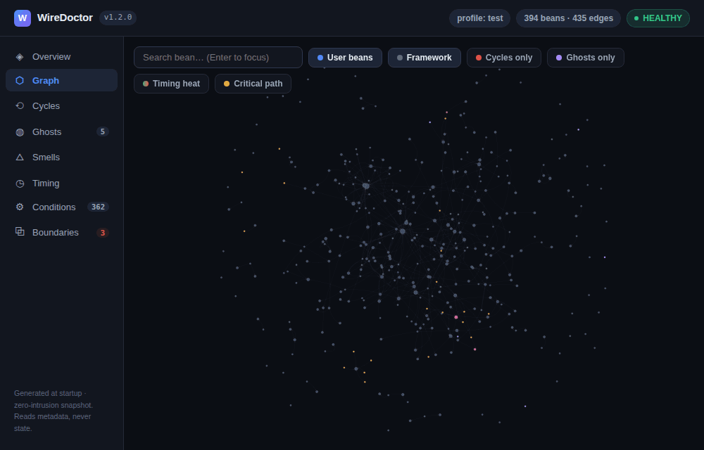

---

## Cycles tab

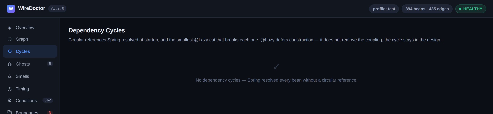

WireDoctor's Tarjan SCC detector runs on the **resolved** graph and lists every circular dependency, plus the smallest `@Lazy` cut that breaks each one. On this real run it finds **none** — *"No dependency cycles — Spring resolved every bean without a circular reference."*

That is the honest, common case for a well-kept codebase, and it is worth showing: the detector is always on, so the day a cycle sneaks in (a new `@Autowired` back-edge), it turns red here and — with the baseline committed — fails CI via the [regression gate](ci-gating.html). A clean tab today is the baseline that makes tomorrow's regression visible.

---

## Ghosts tab

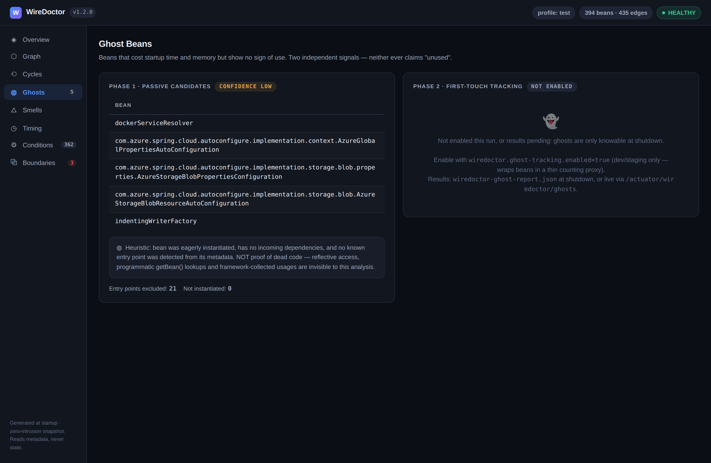

Beans that cost startup time and memory but show no sign of use — eagerly instantiated ∧ zero incoming dependencies ∧ no detectable entry point (`@Controller`, `@Scheduled`, `CommandLineRunner`, …). Deliberately labeled **`CONFIDENCE LOW`** — it is a static signal. On this run it flags **5 candidates**, among them `dockerServiceResolver` and `indentingWriterFactory` plus a few Azure autoconfiguration beans that are wired but never reached on this path.

An opt-in **first-touch tracker** (`wiredoctor.ghost-tracking.enabled=true`, dev/staging only) goes further — wrapping eligible beans in a counting proxy and reporting touched/untouched at shutdown or via `/actuator/wiredoctor/ghosts`. WireDoctor never claims "unused", only "never invoked during this run" — the distinction is printed right in the UI.

---

## Smells tab

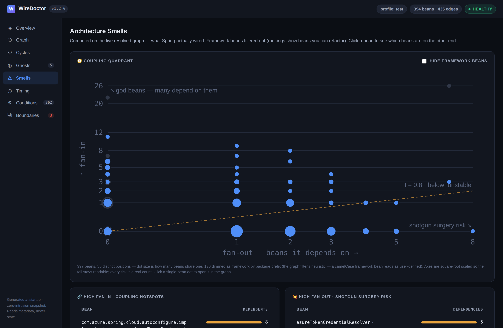

Architecture smells on the **live resolved graph** — what Spring actually wired. Framework beans are filtered out of the rankings so every row is something you can act on:

- **High fan-in · coupling hotspots**: `AzureTokenCredentialAutoConfiguration` tops it with **8 dependents** — change it and the blast radius is widest.
- **High fan-out · shotgun-surgery risk**: `azureTokenCredentialResolver` leads with **5 dependencies**.
- **Unstable beans**: ranked by instability `I = fanOut / (fanIn + fanOut)`; `commandLineMetadataController` sits at **I = 1.0** (a pure consumer).
- Every row expands to the actual beans on the other end (v1.1.3), and the **coupling quadrant** scatters fan-out vs fan-in against the `I = 0.8` instability line, so you see the shape the top-10 lists hide.

---

## Timing tab

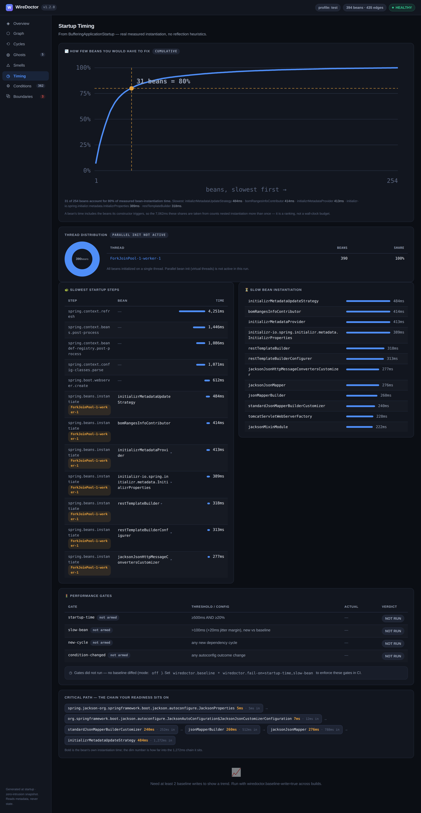

Real measured startup from `BufferingApplicationStartup` — no reflection heuristics:

- **Slow bean instantiation**: every bean over `slow-bean-threshold-ms` (default 100ms), ranked. Here **20 beans** cross it, led by `initializrMetadataUpdateStrategy` (484ms), `bomRangesInfoContributor` (414ms) and `initializrMetadataProvider` (413ms) — the metadata-loading chain Initializr builds at boot.
- **Slowest startup steps**: Boot lifecycle phases, with `spring.context.refresh` (4,251ms) at the top.
- **Thread distribution (v1.1.0)**: which threads instantiated beans — this app initializes across **`ForkJoinPool` workers**, not just `main`, so the card reflects genuine parallel init.
- A **Pareto curve** of cumulative instantiation time with the 80% knee, and **Performance gates** (v0.7.1) — each with its threshold, actual value, and a PASS/FAIL/NOT RUN chip — the UI counterpart of `wiredoctor.fail-on` ([Performance Gates](performance-gates.html)).

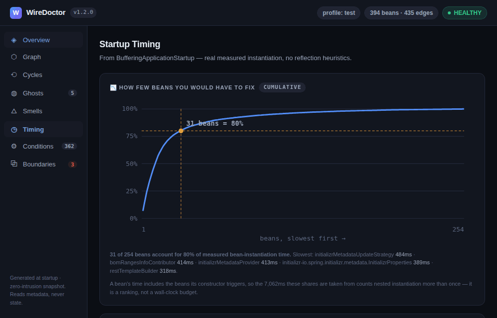

---

## Conditions tab

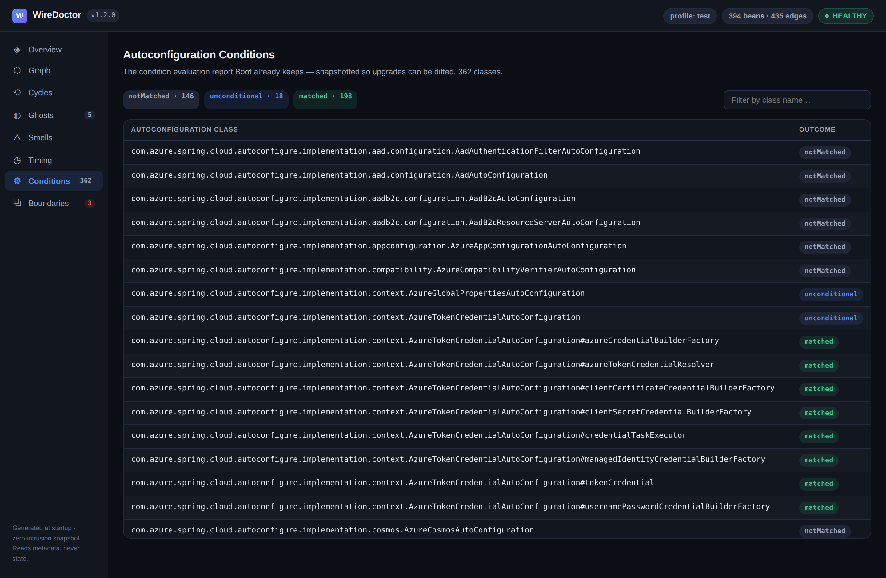

Spring Boot's **condition evaluation report**, snapshotted into the report — **362 autoconfiguration classes** here (198 matched · 146 notMatched · 18 unconditional), each tagged and filterable by class name.

Why snapshot something Boot already keeps? Because a snapshot can be **diffed**. Commit it in your baseline and a Boot upgrade that silently flips an autoconfiguration from `matched → notMatched` is caught in CI with the exact condition message — before you debug the mystery of the vanished bean. See the [Upgrade Guard](upgrade-guard.html).

---

## Module Boundaries tab (v1.2.0)

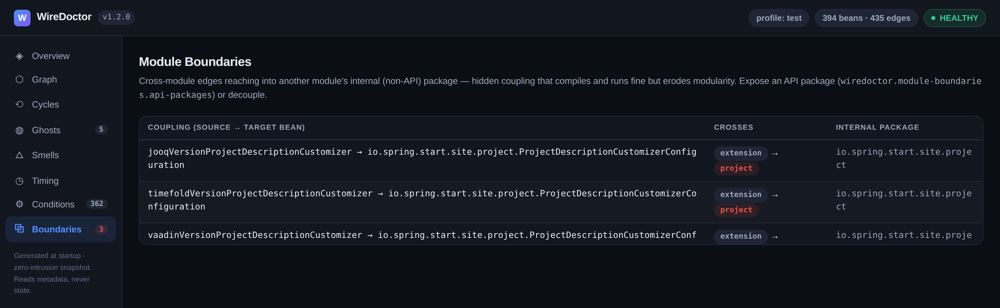

New in 1.2.0, and the reason this tour runs on real Initializr: declare your modules by package prefix and WireDoctor flags every edge that reaches from one module into another module's **internal (non-API)** package — hidden coupling that compiles and runs fine but quietly erodes modularity. It reads the **resolved** graph, so it catches what Spring actually wired, not what the imports suggest.

With `io.spring.start.site.extension` and `io.spring.start.site.project` declared as modules, it finds **3 violations**: `jooqVersionProjectDescriptionCustomizer`, `timefoldVersionProjectDescriptionCustomizer` and `vaadinVersionProjectDescriptionCustomizer` all reach from **extension** into **project**'s internal `ProjectDescriptionCustomizerConfiguration`. Each row names the crossing edge, the modules it spans, and the internal package. The same list lands in `wiredoctor-report.json` under `boundaryViolations`, and `wiredoctor-gate.status` records a `FAIL:boundary-violation` verdict for CI — even with no baseline. See the [Module Boundaries guide](module-boundaries.html).

---

## Try it yourself

Open [this exact report live](https://ddsha441981.github.io/wiredoctor/sample/v1.2.0/wiredoctor-report.html), grab the whole set from [`sample/v1.2.0/`](https://github.com/ddsha441981/wiredoctor/tree/main/sample/v1.2.0), or add the dependency to your own app — the report appears in your working directory on next startup. See [Quick start](https://github.com/ddsha441981/wiredoctor#-quick-start).
